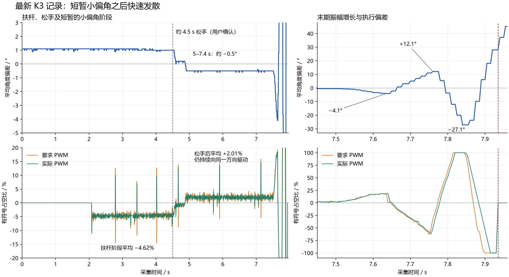

# K3 松手后再次发散：最新数据与参数

数据：`D:/Backup/Downloads/furuta-angle-2026-10-12T11-36-21-614Z.csv`，1984 个样本，9.915 s，5 ms 间隔连续，序号无缺口。用户确认约 4.5 s 完全松手。文中时间均为 CSV 采集时间。

结论：此次松手后有约 3 s 的小偏角阶段，随后出现振幅快速增长的双向摆动，并达到 ±100% PWM 后关断。转臂位置/速度反馈缺失仍是明确的结构问题；末期 PWM 跟不上快速变动的要求值，增加了失稳风险。现有记录无法唯一判断是角度增益/阻尼、物理方向、电机动力学、传感器噪声或它们的组合造成闭环不稳定。

## 最新参数与采集版本要分开

分析开始时读取到 `ANGLE_KP=23661, ANGLE_KI=0, ANGLE_KD=29214, START_PERCENT=65`；当时综合日志确认角度 PID 编译为 23661/0/29214，位置 PID 为 0/0/0。

分析期间用户继续调参。19:41:10 保存的最新源码为：

| 参数 | 当前有效值 | 说明 |
| --- | ---: | --- |
| ANGLE_KP | 29661 | Q16.16，约 0.452591 %/ADC 计数 |
| ANGLE_KI | 0 | 无角度积分 |
| ANGLE_KD | 35214 | Q16.16，约 0.537323 %/ADC 相邻差分计数 |
| POSITION_KP / KI / KD | 0 / 0 / 0 | 位置反馈仍关闭 |
| START_PERCENT | 63 | 只作用于 K1/S 起摆脉冲，不用于 K3 平衡 |
| CENTER | 1011 | 顶层覆盖控制模块默认的 1014 |
| PULSE_MS | 120 | 顶层覆盖控制模块默认的 100，同样不用于 K3 |
| MOTOR_INVERT | 1 | 需实物验证的电机方向约定 |
| 角度 PID 周期 | 5 ms | 原始 ADC 控制反馈 |
| PWM | 20 kHz，2500 计数为 100% | SLEW_STEP=4，换向等待 DEAD_CYCLES=8 |

后续综合日志也出现 `pid_fixed(KP=29661,KI=0,KD=35214)`。然而这份 CSV 在 19:36:21 导出，早于该次参数修改，因此不能用它评估 29661/35214 的实物效果。CSV 没有固件 ID，编译成功也不等于已烧录，不能仅凭磁盘最新源码认定采集板卡运行相同版本。已将分析时的源码及哈希保存到本目录，避免继续调参覆盖依据。

## 松手后的数据说明了什么

2.080 s 出现首个控制请求。2.2～4.5 s 仍扶着摆杆时，角度均值 +1.048°，要求 PWM 均值 -4.618%，实际均值 -4.588%。如果这一姿态确为机械竖直，需检查零点；若人为扶杆有偏斜，则不能据此认定 CENTER 标定错误。扶杆期间恒定驱动也可能已经改变转臂状态，不能把角度平稳视为完整系统已进入平衡。

5.0～7.4 s 完全松手后，角度均值 -0.506°，标准差 0.027°，但要求 PWM 均值 +2.008%，实际均值 +2.020%。这不是停止驱动的状态，也不能证明转臂的位置和速度稳定：CSV 没有这两个变量。

| 时间 / s | 平均角度 / ° | 要求 PWM / % | 实际 PWM / % | 现象 |
| --- | ---: | ---: | ---: | --- |
| 5.000 | -0.5 | +1.80 | +1.80 | 小偏角下仍有同向驱动 |
| 7.635 | -4.1 | +19.28 | +18.20 | 第一个可见负向峰 |
| 7.760 | +12.1 | -31.84 | -51.12 | 下一反向峰幅值增大 |
| 7.840 | -27.1 | +100.00 | +100.00 | 再次反向并饱和 |
| 7.880 | -9.8 | -54.32 | +8.84 | 要求已换向，实际仍为旧方向 |
| 7.920 | +28.0 | -100.00 | -100.00 | 正向偏离扩大 |
| 7.935 | +28.0 | 0 | 0 | 驱动撤销，之后平均角度继续增大 |

幅值 -4.1°、+12.1°、-27.1° 的快速增长表明闭环没有有效耗散这段运动。由于角度采用 16 点平均，而 PID 使用瞬时原始 ADC，上表不是精确的原始角度峰值；不能直接用显示角度与同时刻 PWM 的符号判定反馈方向。

末期 7.635～7.930 s，要求与实际 PWM 差值 RMS 为 21.252 个百分点；7.880 s 的符号相反偏差达到 63.16 个百分点。它与 PWM 缓降到零、换向等待、再缓升的实现一致。它可能加重末期振荡，但不是证明“去掉缓升就能平衡”：7.5～7.635 s 初次偏离阶段的差值 RMS 只有 0.841 个百分点，控制器要求值本身也已造成未收敛的运动。

7.935 s 归零符合停机/保护状态，但 CSV 没有 state 和 fault，因此不能确认具体保护码或排除手动停机。平均角度滞后，也不能从关断时平均 +28° 就断言角度保护阈值设置为 28°。当前原始 ADC 窗口 CENTER±500 对应标称约 ±40.66°。

## 为何增大 P 和 D 后仍可能发散

1. **主要控制结构没有改变。** `POSITION_KP/KI/KD` 全为零，位置 PID 被综合优化掉；顶层速度输出仍接 `velocity_unused`，速度测量的 divider 也被优化掉。K3 捕获原点、OLED 显示编码器并不等于位置/速度参与控制。缺少这两条反馈不能限制转臂持续漂移与速度变化。

2. **D 相对 P 没有增加。** PID 的计算是 `u=KP*e+KD*(e[k]-e[k-1])`，KD 是离散增益。23661/29214 下，等效 D/P 时间常数为 6.173 ms；最新 29661/35214 下为 5.936 ms。P 增加约 25.36%，D 增加约 20.54%，D/P 比例反而下降约 3.84%。不能据此推出闭环阻尼的精确数值，但也不能把“两项数值都加大”当作已经增加相对制动作用。

   在固定目标、标称 333°/4095 换算下，最新增益的工程单位近似为 `u[%]≈-5.5656*angle[°]-0.03304*angular_velocity[°/s]`。10°/s 只有约 0.330 个百分点的 D 项，而 1° 就对应 5.566% 的 P 项。不要把 KD 直接乘 200；离散增益的定义、ADC 噪声和执行限制要一起处理。

3. **显示平稳掩盖了控制输入的瞬时变化。** 5～7.4 s 平均角度仅 -0.6～-0.4°，要求 PWM 却有 -5.76～+15.88% 的瞬时范围。其标准差为 1.307 个百分点；要求/实际差值 RMS 为 1.707 个百分点。可能来自原始 ADC 噪声、短时机械扰动或二者，现有平均角度不足以区分。继续提高未滤波的差分增益可能放大这些尖峰。

4. **实物反馈方向仍未由本记录验证。** PWM 回传已经还原 MOTOR_INVERT 接线翻转，两个 PWM 字段符号一致不能证明电机作用方向正确。需要有限幅值的小扰动响应，确认摆杆 ADC、转臂编码器和电机正方向。仅从本次闭环峰值也不能直接决定把 MOTOR_INVERT 翻转。

## 下一步

优先记录转臂相对位置、转臂速度、原始 ADC、PID 的 P/D 分量以及 state/fault，并标记松手时刻和固件参数版本。再核实机械零点与恢复方向，加入经标定的转臂速度阻尼和位置保持，结合噪声处理重新设计角度 PD。增加 P/D 或调整 START_PERCENT 都没有解决缺失的转臂反馈；特别是 START_PERCENT 不参与这次 K3 输出。

目前的单次记录不足以给出可信的“保证稳定”增益，电机供电、摩擦、机械间隙和转矩也未被实际 PWM 测量验证。[Quanser 控制说明](https://www.quanser.com/blog/control-systems/rotary-pendulum-control-challenge-with-qube-servo/)介绍了角度 PD 和基于转臂/摆杆位置、速度的状态反馈，并强调实物方向约定；这些方法需要本装置的参数与响应，不能直接照搬另一套设备的增益。

