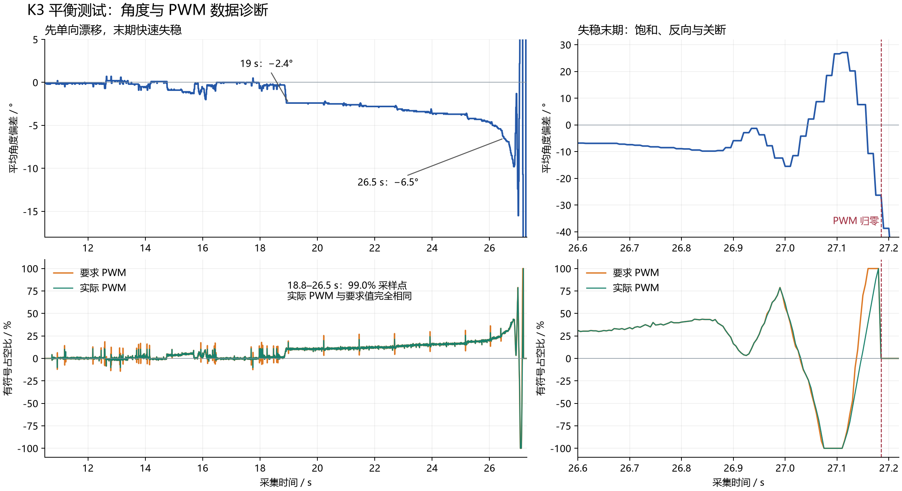

# K3 扶直松手后的发散分析

结论：记录显示控制器持续增大同一方向的驱动，转臂越来越快，随后摆杆失稳。证据最强的控制结构问题是转臂位置环关闭、编码器速度未用于反馈；现有角度 D 项的连续等效作用也很弱。PWM 执行跟踪在最初漂移阶段良好。机械反馈方向、摩擦、零点及电机供电还不能仅由这份 CSV 排除。

数据源：`D:/Backup/Downloads/furuta-angle-2026-10-12T11-25-22-944Z.csv`。用户确认按 K3，在维持直立后松手，并观察到转臂越转越快；没有提供准确松手时刻。以下时间均为 CSV 的采集相对时间，不是按 K3 或松手后的时间。

## 观测证据

6439 个样本，跨度 32.205 s，只有一处 20 ms 序号间隔，合计缺 3 个 5 ms 样本。该缺口在 27.230～27.250 s，已经晚于失稳及 PWM 关断，不能解释此前数秒的持续漂移。有效控制请求始于 10.735 s，最后非零请求为 27.180 s。

| 采集时间 / s | 平均角度 / ° | 要求 PWM / % | 实际 PWM / % |
| --- | ---: | ---: | ---: |
| 19.000 | -2.4 | +10.08 | +10.08 |
| 24.000 | -3.6 | +15.16 | +15.16 |
| 26.300 | -5.3 | +23.08 | +23.08 |
| 26.500 | -6.5 | +29.20 | +29.20 |
| 26.800 | -8.9 | +40.40 | +40.40 |
| 27.000 | -15.5 | +56.80 | +61.56 |
| 27.080 | +18.5 | -100.00 | -100.00 |
| 27.180 | -26.3 | +100.00 | +100.00 |
| 27.185 | -26.3 | 0 | 0 |

18.8～26.5 s 的 99.0266% 采样点中，实际 PWM 与要求 PWM 完全相同；两者符号没有相反的采样点。PWM 差值 RMS 为 24.627 计数，即 0.985 个占空比百分点。因此最初的单向漂移主要不是 FPGA 缓升导致的要求值执行不出来。实际 PWM 是 FPGA 占空比，不是电机转矩、电流或实测转速，不能因此证明电机驱动电源/机械执行完全正常。

约 27.075 s 开始出现要求 PWM 饱和到 ±100%；末期反向时执行限制会产生偏差。27.185 s 两者立即归零，表明驱动被撤销，结合控制代码与随后角度越界，符合保护动作；由于 CSV 不含 state/fault，不能确认具体故障码或排除手动停机。

## 控制代码中的原因

### 转臂位置和速度没有形成闭环

`src/rtl/control_core.v:11` 中 `POSITION_KP=0, POSITION_KI=0, POSITION_KD=0`，所以位置 PID 的输出始终为零，`target_angle=CENTER*65536`，不会根据转臂偏离起点来修正目标。K3 捕获位置原点仍在，但捕获原点本身不会产生位置保持作用。

`src/board/acg720_top.v:92` 将编码器速度接到 `velocity_unused`，没有送入控制器。当前控制器不能根据转臂越转越快增加速度阻尼。显示 OLED 编码器计数不等于闭环使用编码器。

这是与用户观察最吻合的结构缺口。它使控制器可能在摆杆有小偏差时持续向同一方向驱动，转臂速度和位置漂移没有相应校正。随着速度增大，摩擦、电机反电动势和旋转系统耦合会改变实际动力学，单靠角度误差增大 PWM 未能维持直立。此因果解释是结合代码、波形及用户观察的推断，并非这份 CSV 已测出了转臂速度。

### 当前角度 PD 在慢变阶段几乎由 P 项决定

采集前发布源码 `build/releases/furata_uart_telemetry_20261012_source/src/rtl/control_core.v` 的增益为 `KP=23661/65536=0.361038`、`KI=0`、`KD=23214/65536=0.354218`，以下数值按该版本核算；CSV 本身不含固件标识，因此不能单靠 CSV 确认实际烧录版本。误差单位是 ADC 计数；控制周期为 5 ms。`pid_fixed.v` 的 D 项是 `KD*(e[k]-e[k-1])`，参数被定义为离散增益，代码没有自动除以周期。

按顶层标称比例 333°/4095，在目标不变、零点和符号按当前代码时，可写成近似工程单位：

```text
u[%] ≈ -4.4398 × angle[deg]
       -4.3559 × (angle[k]-angle[k-1])[deg]
     ≈ -4.4398 × angle -0.02178 × angular_velocity[deg/s]
```

这不是要求把 KD 直接乘 200。离散增益与连续微分增益的定义不同，重新调参应明确单位，并处理 ADC 噪声。举例说，10°/s 的摆杆角速度只对应约 0.218 个占空比百分点的 D 项，而 5° 的偏角对应约 22.2% 的 P 项，说明这组设置的角速度制动作用很小。

18.8～26.5 s 从 CSV 拟合得到 `要求PWM[%] ≈ -4.4414 × 平均角度[°] -0.0992`，斜率与代码 P 项 4.4398 几乎一致。这支持慢变阶段主要由 P 项控制。CSV 的角度是 16 点平均，而 PID 使用未平均的原始 ADC，不能据此精确还原每个采样点的 P/D 分量，也不能把拟合残差全当成 D 项。

分析过程中发现用户在 19:33:48 保存了新的 `ANGLE_KD=29214` 和 `START_PERCENT=70`。KD 比原值增加约 25.85%，对应连续等效 D 系数约 0.02741 %/(°/s)，D/P 时间常数约 6.17 ms；转臂位置增益仍全为零，速度反馈仍未接入。START_PERCENT 只影响 K1/S 的起摆脉冲，不参与 K3 平衡输出，改为 70 不会改善这次 K3 试验。上述编辑未被本次分析改动。

### 实物方向仍需确认

当前 `MOTOR_INVERT=1`；回传的要求/实际 PWM 都已去掉接线翻转。因此“角度为负、PWM 为正”只能证明软件符号一致，不能证明这个方向在实物上产生恢复作用。方向反了也会发散；这份单次闭环记录不足以将其排除。更改方向应依据有限幅值的小扰动响应，同时确认摆杆 ADC 方向、转臂编码器方向与电机方向。

## 后续修改优先级

1. 保持小范围测试，先核实实物恢复方向与零点；目前观测不能支持直接放大 Kp。
2. 把有符号转臂位置和速度用于闭环，并恢复位置约束。速度、位置和角度的正方向及单位应一致；速度估计需要处理量化和停止时的旧值，不能直接把未验证的 `velocity_unused` 接到一个任意增益上。
3. 根据实际 5 ms 周期和 ADC 噪声重新设计角度 PD 阻尼。不要用网页的 16 点显示平均直接替代控制反馈，也不要把离散 KD 机械乘 200。
4. 下一次记录加入转臂位置、转臂速度、原始 ADC、控制 state 和 fault。这样可以区分持续转动、方向错误、位置越界、角度越界和传感器问题，并检查反馈符号。

KI 当前为零，所以本次不是积分饱和累积。引入角度积分不能代替转臂位置/速度反馈，不应作为越转越快问题的首个修复。

## 数据末端的角度跳变

27.250 s 的 -76.4° 随后跳到 27.275 s 的 +240.7°，发生在 PWM 已归零之后。当前显示转换是线性 ADC 零点换算，没有 ±180° 包角，电位器存在端点/盲区。该跳变可能与摆杆经过电位器端点有关，不能直接把它解释成 25 ms 内完成同等物理转角，也不能用于计算末端角速度。

## 理论参考

[Quanser 旋转倒立摆控制说明](https://www.quanser.com/blog/control-systems/rotary-pendulum-control-challenge-with-qube-servo/)将摆杆与转臂的位置和速度列为系统输出，介绍 PD、极点配置和 LQR 平衡控制，并强调传感器/执行器的方向约定需与实物一致。这支持后续采用完整状态反馈或经验证的级联控制，并不提供本装置可直接复制的增益。


